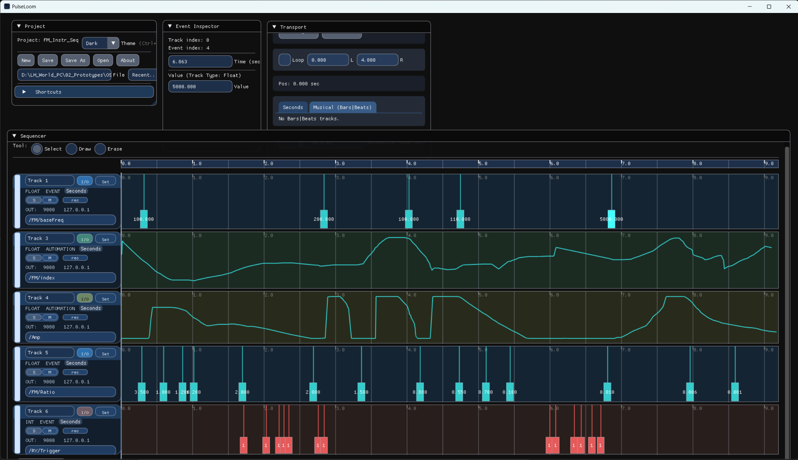

# PulseLoom (OSC Sequencer)

PulseLoom is an OSC sequencing software tool created by Hao Liu / 刘昊 (also credited as Liu Hao), a new media artist, composer, and independent software developer.

Designed for experimental music, interactive systems, and custom audiovisual workflows, PulseLoom sequences OSC control data over time through tracks, curves, and events. It forms part of Hao Liu's wider practice across electronic music, audiovisual systems, creative coding, and software instruments.

## Links

- **Hao Liu / 刘昊:** https://liuhao-art.com
- **Apps & Software:** https://liuhao-art.com/apps/apps
- **GitHub Repository:** https://github.com/live-a11y/PulseLoom
- **Download (Windows, v0.210):** https://github.com/live-a11y/PulseLoom/releases/tag/v0.210

## What it does

PulseLoom helps you design and play back control timelines, curves, and events that drive external engines via OSC.

It sits between your ideas and your sound engine — such as Max/MSP, Csound, SuperCollider, etc. — as a focused control layer for experimental music and interactive audiovisual work.

## Key features

* Track-based sequencing with multiple lanes and targets
* Automation-style curves for smooth parameter changes
* Per-track OSC routing, including target host, port, and OSC address
* MIDI input control for external controllers
* Session save/load for repeatable setups
* Designed for experimental music, modular/interactive systems, and custom audio workflows
